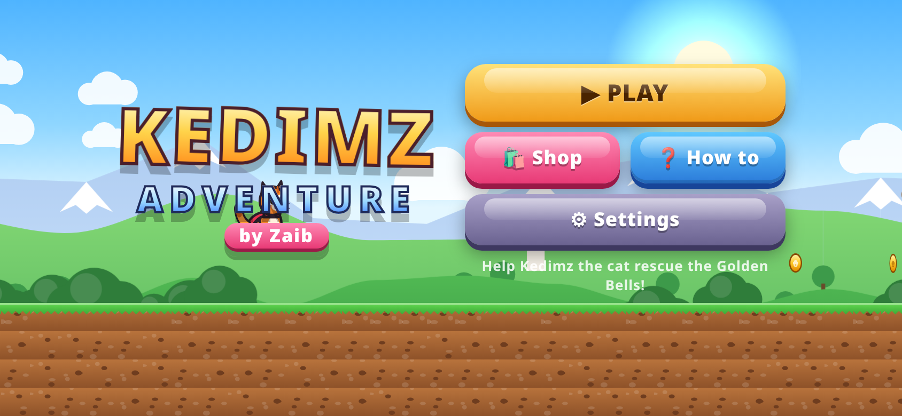
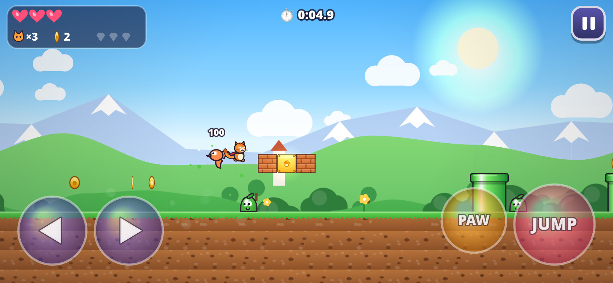

# Kedimz Adventure 🐱

**A mobile-first side-scrolling platformer. Game by Zaib.**

▶ **Play:** https://wahidzeb.github.io/kedimz-adventure/

Kedimz the cat sets out to bring back the Golden Bells. There are 5 worlds with 4 levels each (20 levels), and every world ends in a boss fight.

## Features
- **Tight controls:** coyote time, jump buffering, variable jump height and run momentum, plus corner correction.
- **5 worlds:** Meadow Hills, Sunscorch Desert, Frostbite Caverns, Ember Castle and Cloud Kingdom. Each has its own parallax scenery, enemies, hazards and chiptune music.
- **5 bosses:** Mole King, Scarab Pharaoh, Yeti, Magma Golem and Storm Owl.
- **Level pieces:** stomping, breakable bricks, paw blocks, hidden blocks, coins, secret bonus rooms through warp pipes, checkpoints, moving, falling and lift platforms, springs, spikes and lava.
- **Power-ups:** Size Up, Fire Paw, Ice Paw, Wings (double jump), Coin Magnet and Star (invincibility).
- **World map:** collect 3 gems per level and beat your best time.
- **Shop:** spend coins on cat skins, hats and upgrades (extra heart, start big, magnet range, extra lives, lucky coins).
- **Forgiving damage:** you shrink first, then lose a heart. Falling into a pit costs a heart and puts you back on safe ground. Collecting 100 coins gives an extra life.
- **Juice:** squash and stretch, particles, screen shake, a smooth camera, procedurally composed WebAudio chiptune music and sound effects.
- **Saving:** progress is stored in localStorage. Settings cover sound, music, vibration, control style (buttons or joystick), button size, left-handed layout, graphics quality and a progress reset.
- **Performance:** a single self-contained HTML file with no dependencies. It runs at 60 fps using delta time, drops graphics quality automatically if the frame rate falls, and pauses when the tab is hidden.

## Controls
| Action | Touch | Keyboard |
|---|---|---|
| Move | ◀ ▶ buttons (or joystick) | ← → / A D |
| Run | keep holding a direction and Kedimz speeds up into a run | same |
| Jump | JUMP (hold for a higher jump) | Space / ↑ / W / Z / K |
| Paw swipe / Fire / Ice / Enter pipe | Action button (PAW / FIRE / ICE / ENTER) | X / J / C / Shift; ↓ / S also enters pipes |
| Pause | ⏸ button | Esc / P |

Landscape is recommended; portrait is supported with a control deck below the level.

## Credits
Game, art, music and code by **Zaib**. All characters, art and music are original.
